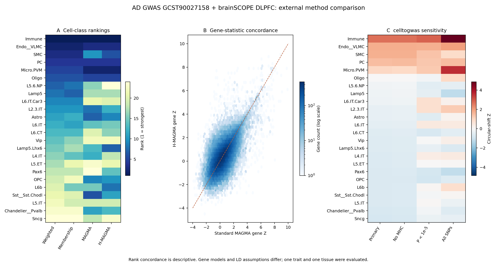

# celltogwas

Regulatory-aware mapping and exploratory enrichment of GWAS loci across cell
types.

**Experimental 1.1.0a1:** continuous gene programs, dense/sparse evidence kernels,
SVD nuisance adjustment, FFT shared circular randomizations and selection-adjusted
adaptive minP tests. See [the mathematical specification](docs/ADAPTIVE.md) and
[measured calibration/power and real-data limits](docs/ADAPTIVE_RESULTS.zh-CN.md).
The stable [1.0.0 baseline](https://github.com/ForrestGump618/celltogwas/releases/tag/v1.0.0)
is preserved. The adaptive method assumes residual genomic cyclic exchangeability;
it does not provide arbitrary-LD validity or establish previously unknown causality.

Version 1.0 is a rebuild of the original single-file toolkit. It keeps the
legacy `cell2gwas` API available, but adds weighted genomic domains, expression
specificity scores, vectorized interval lookup, spatial permutation tests,
multiple-testing correction, a command-line interface, and reproducible run
manifests.

## What changed

- Gene-level GTF/GFF3 parsing with correct 1-based to 0-based coordinate
  conversion.
- Weighted gene-body, promoter and optional regulatory BED annotations.
- Continuous distance-decayed SNP-to-cell-type scores instead of only 0/1
  interval membership.
- Gene weights derived from cell-type expression specificity using Tau,
  normalized entropy, or robust cross-cell-type z-scores.
- Vectorized annotation with chunking and per-chromosome weighted interval
  indexes.
- Within-chromosome circular permutation enrichment with FFT-accelerated
  circular correlations.
- Benjamini-Hochberg FDR correction across cell types.
- Strict input validation, diagnostics, JSON manifests and input SHA-256 hashes.
- Python package metadata, CLI entry point, tests, lint configuration and CI.

See [docs/METHODS.md](docs/METHODS.md) for the mathematical definitions and
[docs/MIGRATION.md](docs/MIGRATION.md) for compatibility notes.

## External real-data example

The release includes an actual brainSCOPE adult DLPFC pseudobulk / AD GWAS
comparison: 24 cell classes, 352 donor IDs, and 14,161,368 autosomal SNPs from
GCST90027158, matched by rsID to the GRCh37 1000G EUR reference. The accession
metadata cites the Bellenguez 2020 preprint; it is not asserted to be the full
final 2022 publication dataset.

- The prespecified `P <= 5e-8` primary analysis has **no cell class at BH q < 0.05**.
- The all-SNP exploratory sensitivity identifies Immune and Micro.PVM at
  q < 0.05, also identified by standard MAGMA; H-MAGMA has no class passing
  BH q < 0.05 in this example.
- Primary cell-class rank Spearman rho is 0.507 with MAGMA and 0.506 with
  H-MAGMA. Gene-level MAGMA/H-MAGMA rho is 0.601 across 53,021 common genes;
  native-universe top-1,000 overlap is 570.
- These are descriptive comparisons from one disease and one tissue. They
  do not establish causality, equivalence to an LD-aware model, or general
  predictive accuracy.

See the [real-data report](docs/REAL_DATA_VALIDATION.zh-CN.md),
[acceptance report](docs/ACCEPTANCE_REPORT.zh-CN.md), and
[reproduction instructions and input checksums](validation/README.md).
Compact numerical results are versioned in [validation/results](validation/results).
The software suite has 49 tests; external tool runs and input/output evidence
are included with the GitHub Release.



## Install

Python 3.10 or newer is required.

```bash
python -m pip install .
```

For development:

```bash
python -m pip install -e ".[dev]"
python -m pytest
python -m ruff check .
```

## Quickstart

### 1. Derive marker weights from expression

The expression table should have genes in rows and cell types in columns.
Values must be non-negative, for example TPM, CPM, or normalized pseudobulk
counts.

```text
gene,T_cell,B_cell,Myeloid
CD3D,18.2,0.0,0.1
MS4A1,0.0,15.1,0.2
LYZ,0.1,0.1,22.4
```

```bash
celltogwas specificity \
  --expression expression.csv \
  --output markers.csv \
  --gmt-output markers.gmt \
  --method tau \
  --top-n 2000 \
  --report specificity-report.json
```

The output contains `cell_type`, `gene`, `weight`, `specificity`,
`relative_expression`, and `max_expression`. `markers.gmt` can be supplied
directly to the annotation commands.

### 2. Annotate GWAS SNPs

```bash
celltogwas annotate \
  --gtf gencode.v44.annotation.gtf.gz \
  --gene-sets markers.gmt \
  --gwas sumstats.tsv.gz \
  --output annotated.tsv.gz \
  --window 100000 \
  --promoter-window 2000 \
  --kernel exponential \
  --mode weight \
  --report annotation-report.json
```

GWAS column names are detected case-insensitively. Supported chromosome aliases
include `CHR`, `chrom`, `chromosome`, and `#CHR`; position aliases include
`POS`, `BP`, `position`, and `base_pair_location`.

Use `--mode binary` for 0/1 annotations or `--mode both` for both binary labels
and continuous scores. The continuous output is recommended for enrichment
because it preserves distance decay and marker specificity.

### 3. Run cell-type enrichment

```bash
celltogwas enrich \
  --gtf gencode.v44.annotation.gtf.gz \
  --gene-sets markers.gmt \
  --gwas sumstats.tsv.gz \
  --output enrichment.tsv \
  --p-column P \
  --permutations 10000 \
  --seed 13 \
  --report enrichment-report.json
```

The test asks whether trait-associated SNPs have higher cell-type link scores
than expected under annotation shifts within each chromosome. It returns:

```text
cell_type, observed_link_score, z_score, fold_over_null, empirical_p, fdr_q
```

### 4. Validate inputs before a large run

```bash
celltogwas validate \
  --gtf gencode.v44.annotation.gtf.gz \
  --gene-sets markers.gmt \
  --gwas sumstats.tsv.gz \
  --report validation.json
```

## Python API

```python
from celltogwas import GenomeLinker, LinkConfig

linker = GenomeLinker.from_paths(
    "gencode.v44.annotation.gtf.gz",
    "markers.gmt",
    config=LinkConfig(window=100_000, promoter_window=2_000),
)

annotated = linker.annotate(gwas, mode="weight")
enrichment = linker.enrich(
    gwas,
    p_column="P",
    n_permutations=10_000,
    random_state=13,
)
```

`EnrichmentResult` provides both the table and diagnostics:

```python
from celltogwas import run_enrichment

result = run_enrichment(
    annotated,
    cell_types=["T_cell", "B_cell", "Myeloid"],
    n_permutations=10_000,
)
print(result.table)
print(result.diagnostics)
```

## Input formats

### Gene annotation

- GTF2 or GFF3, plain text or gzip.
- `feature_type=gene` is used by default. This avoids counting transcript rows
  as independent genes.
- Gene identifiers are resolved by both `gene_name`/`Name` and
  `gene_id`/`ID`, so a gene set may use symbols or Ensembl IDs.

### Gene sets

- GMT: first two fields are set name and description; remaining fields are
  genes. `GENE:WEIGHT` is accepted for weighted markers.
- JSON: `{"cell_type": {"GENE": weight}}` or arrays of genes.
- CSV/TSV long form: required cell-type and gene columns; weight is optional.
- CSV/TSV wide form: first column is gene, remaining numeric columns are cell
  types.

### Regulatory intervals

BED-like intervals may be supplied with `--regulatory`. Accepted forms include:

- `chrom start end cell_type weight`
- a header with `chrom`, `start`, `end`, `cell_type`, and optional `weight`
- BED3 plus `--regulatory-cell-type`; a shared default weight is then used

Coordinates in BED and all internal indexes are 0-based, half-open. One-based
GWAS positions are converted internally.

## Mathematical model

### Weighted cell-type domains

For cell type `c`, gene `g`, and SNP position `x`, the annotation is the
maximum active interval weight:

```text
S_c(x) = max { w_gi : x in I_gi }
```

Gene bodies, promoters, distance bands and optional regulatory elements are
combined this way, so overlapping evidence is not double counted. For an
exponential kernel with scale `gamma`:

```text
K(d) = exp(-d / gamma)
```

Distance bands make this compatible with logarithmic interval lookup. The
number of bands is controlled by `--kernel-levels`.

### Expression specificity

For gene expression `x_gc` across `C` cell types:

```text
tau_g = sum_c (1 - x_gc / max_c(x_g)) / (C - 1)
relative_gc = x_gc / max_c(x_g)
marker_gc = (tau_g * relative_gc) ** power
```

Entropy and median/MAD-based robust z-score alternatives are available. Relative expression weights cell types within each gene. These ratios are scale-invariant across a gene; use `min_expression` to exclude genes with very low absolute expression.

### Spatial enrichment

Trait-associated SNPs receive evidence weights `w_i`, for example
`-log10(P_i)`. For cell type `c`:

```text
T_c = sum_i w_i * S_ic / sum_i w_i
```

The null distribution is generated by circularly shifting `S_ic` with respect
to `w_i` inside each chromosome. This preserves local annotation clustering
better than an independent-SNP permutation. FFT circular correlations compute
all shifts efficiently. Empirical p-values use the plus-one correction and are
adjusted across cell types with Benjamini-Hochberg FDR.

Evidence may be supplied as `-log10(P)` (`--score-mode pvalue`), absolute
effects (`abs`), robustly standardized absolute effects (`zscore`), or uniform
weights. The `zscore` mode fits a median and scaled MAD and records both in the
JSON report.

`p_upper` assigns zero evidence above the threshold while retaining all valid SNPs as the circular-shift background. `run_enrichment_by_chromosome` combines independent per-chromosome shifts with bounded memory and child seeds derived from the root seed.

## Scientific scope and limitations

- Proximity is not causality. Gene-body and window annotations are hypotheses;
  supply matched cell-type regulatory intervals, eQTL links, ABC links, or
  chromatin-interaction maps when available.
- The circular permutation test is an exploratory annotation-enrichment test.
  It does not directly model linkage disequilibrium, partition SNP
  heritability, perform fine-mapping, or replace stratified LD score
  regression.
- The GWAS and gene annotation must use the same genome assembly. The package
  does not silently lift over coordinates.
- Gene symbols are not a complete ontology. Ambiguous symbols can match more
  than one gene record; use stable gene IDs when possible.
- Cell-type labels from different studies are not automatically harmonized.
  Preserve the source ontology and marker provenance in your analysis record.
- An empirical p-value requires enough permutations and adequate SNP density
  per chromosome. Chromosomes with fewer than four eligible variants are
  excluded from the inference and listed in diagnostics.

## Legacy compatibility

The original functions remain importable:

```python
from celltogwas.cell2gwas import (
    extract_gene_info,
    merge_intervals,
    celltype_genome_range,
    check_value_in_intervals,
    gwas_annotation,
    gwas_annotaion,  # historical misspelling
)
```

Legacy outputs keep their one-based `GENE/CHR/START/END` and string `"1"`/`"0"`
annotation conventions. The parser and coordinate handling are corrected
underneath. See [docs/MIGRATION.md](docs/MIGRATION.md).

## Scientific background

This implementation is informed by:

- MAGMA gene/gene-set analysis (de Leeuw et al., 2015)
- H-MAGMA chromatin-interaction-aware gene mapping (Sey et al., 2020)
- sc-linker single-cell and regulatory variant-to-cell-type linking
  (Jagadeesh et al., 2022)
- stratified LD score regression concepts and their distinction from
  annotation enrichment (Finucane et al., 2018)
- CELLEX expression specificity (Timshel et al., 2020)
- the Tau expression-specificity index (Yanai et al., 2005)
- GREAT cis-regulatory domains (McLean et al., 2010)

Links:

- https://doi.org/10.1371/journal.pcbi.1004219
- https://doi.org/10.1038/s41593-020-0603-0
- https://doi.org/10.1038/s41588-022-01187-9
- https://doi.org/10.1038/s41588-018-0081-4
- https://doi.org/10.7554/eLife.55851
- https://doi.org/10.1093/bioinformatics/bti042
- https://doi.org/10.1038/nbt.1630

## License

GPL-3.0-only. See [LICENSE](LICENSE).

