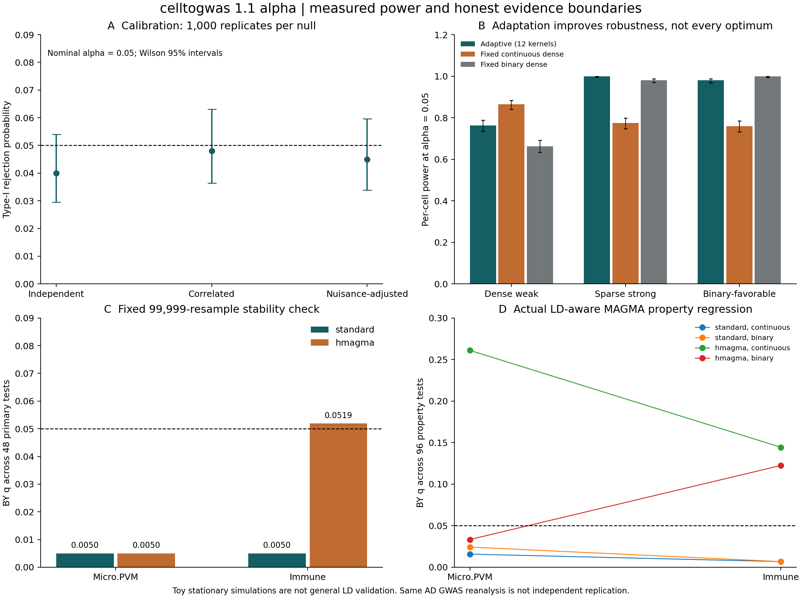

# celltogwas 1.1.0a1 算法增强与真实验收

日期：2026-10-30。性质：实验性算法版本，不替代已发布的 1.0.0 主分析。

## 结论先行

已实现连续基因程序、多尺度稀疏/稠密证据、自适应最小 P 值的选择校正、SVD 协变量调整及共享染色体循环置换。
在明确的模拟条件下改善了相对固定二元基线的统计功效，同时观察到适应性选择带来的功效代价。
**尚未证明发现了既往未知的关键关联，也没有完成独立队列复现。**

真实数据中的主要信号仍为 Immune、Micro.PVM。不同统计模型和重采样精度并非完全一致，不能只保留显著的结果。
本版本因此标为 alpha；不存在“算法保证发现新关联”的承诺。

## 1. 具体改进

- 不再只依赖 top-1,000 二元 marker：保留完整实测背景，使用连续 Tau 特异性权重。
- 固定权重幂 1、2、4，另设 top-10% 二元核；与稠密、残差 Z 超过 2/4 的稀疏证据组合，共 12 核。
- 用 SVD 投影处理共线协变量；在基因长度、SNP 数、模型参数数、样本量和平均表达等方面进行调整。
- 用有符号 FFT 相关计算所有循环位移；所有核和细胞类型共享同一组位移，保留其相关结构。
- 对每个置换重新执行最优核选择，再校正观察值，避免直接报告最小 P 值的选择偏倚。
- 同时提供 Holm、BY，以及明确标为探索性的 BH。BY 不能挽救无效的基因组零假设。
- 未使用以当前 GWAS 的最小 P 值为适应度的遗传算法；这种搜索需要独立训练与验证，不能作为新发现证据。

数学定义、假设、API 与引用见 [ADAPTIVE.md](ADAPTIVE.md)。

## 2. 固定设计的功效与校准

512 个模拟基因、3 个细胞程序、每次 999 次共享置换；每个场景 1,000 次，共 6,000 次独立模拟。
设计种子 1301、结局种子 20261030。参数与源码 SHA-256 在运行前写入 protocol.json。
所有方法使用相同数据、协变量、随机位移和经验 P 值；固定二元、固定连续核不承担额外的自适应选择代价。
功效为目标细胞在单项 alpha=0.05 下的拒绝率，**不是跨细胞 FDR 校正后的功效**。

| 场景 | 自适应 | 固定连续稠密 | 固定二元稠密 |
|---|---:|---:|---:|
| 独立零假设 | 4.0% | 4.3% | 4.1% |
| 相关零假设 | 4.8% | 3.5% | 4.3% |
| 协变量调整零假设 | 4.5% | 5.0% | 4.3% |
| 分散弱信号 | 76.3% | 86.4% | 66.3% |
| 稀疏强信号 | 100.0% | 77.4% | 98.1% |
| 有利于二元核的信号 | 98.0% | 75.9% | 99.9% |

自适应三种零假设的 Wilson 95% 区间分别为 2.95%–5.40%、3.64%–6.31%、3.38%–5.97%。
全家族 Holm 任意假阳性率分别为 4.4%、3.9%、4.9%。
分散弱信号功效的自适应区间为 73.57%–78.83%，二元基线为 63.31%–69.16%。
这说明“比单一二元方案更稳健”，**不说明优于事先知道最优核的方案**，也不证明真实全基因组任意 LD 下的校准。
模拟使用循环平稳 Gaussian 基因序列；并未模拟原始基因型、精细定位、群体分层或供者表达不确定性。

## 3. 同一真实 AD 数据的重分析

沿用 1.0 已核验的 brainSCOPE 成人 DLPFC 单核测序衍生 pseudobulk、GWAS GCST90027158、GENCODEv19、MAGMA/H-MAGMA 基因结果。
这是同一数据的再分析，**不是新的独立外部复现**。原始数据来源、QC、rsID 对齐和版本限制见 [1.0 验证报告](REAL_DATA_VALIDATION.zh-CN.md)。

- 要求 24 类都有供者测量，不把未测量当作零表达；实测表达背景 17,158 个符号。
- 排除有歧义的一对多符号/ID；取标准和 H-MAGMA 结果的交集，共 **12,757 个基因**。
- 平均表达使用原来源的 log-normalized 单位；检测比例阈值 0.1；保留零细胞权重的背景基因。
- 预先固定 19,999 次置换、种子 13；主分析的 24 类 × 两种映射共 48 项一起 BY/Holm 校正。

| 映射 | 细胞程序 | 自适应 P | 全局 BY q（48 项） |
|---|---|---:|---:|
| 标准 | Micro.PVM | 0.00020 | 0.026753 |
| 标准 | Immune | 0.00025 | 0.026753 |
| H-MAGMA | Micro.PVM | 0.00040 | 0.028536 |
| H-MAGMA | Immune | 0.00075 | 0.040129 |

其余细胞类未通过全局 BY 0.05；未宣称出现新的细胞类型关联。

### 固定高精度稳定性检查

由于极小经验 P 值的 Monte Carlo 分辨率有限，追加且只追加一次固定 99,999 次、种子 20261030 的检查。
未根据显著性决定何时停止、也未挑选最有利种子。

| 映射 | 细胞程序 | 高精度 P | 全局 BY q（48 项） |
|---|---|---:|---:|
| 标准 | Immune | 0.00005 | 0.004994 |
| 标准 | Micro.PVM | 0.00007 | 0.004994 |
| H-MAGMA | Micro.PVM | 0.00007 | 0.004994 |
| H-MAGMA | Immune | 0.00097 | **0.051900** |

H-MAGMA Immune 在 BY 0.05 的判定不稳定，不能称为稳健 BY 发现；其高精度 Holm P=0.04365，检验准则不同，不事后切换准则以保住显著性。
循环位移、协变量拟合和基因间距不规则的假设风险，远大于仅增加置换次数能够解决的问题。

### 区域敏感性

在同一固定核族下，分别排除起点位于 chr6:25–35Mb 的基因（不等同于重新移除所有 MHC SNP）和整条 chr19。
标准映射下两个程序均保留 BY 信号；H-MAGMA 的 Micro.PVM 在两项检查中保留，Immune 在去 MHC 时 q=0.061531。
去 chr19 后 H-MAGMA 两程序 q=0.029428。它们只描述区域依赖性，不能替代主分析或作为独立复现。

## 4. 实际运行 LD-aware MAGMA 连续属性回归

不是只比较已发表的排名：实际调用 MAGMA v1.10，读取已完成的 .genes.raw 基因间相关结构。
在同一 12,757 基因背景中，同时检验连续和 top-10% 二元属性；调整八项输入协变量和 MAGMA 内置协变量。
两种映射 × 两类属性 × 24 类，共 **96 项**联合 BY/Holm 校正。标准运行约 27 秒，H-MAGMA 约 26 秒；详细实际耗时以 receipts 为准。

| 映射 | 属性 | 细胞程序 | 全局 BY q（96 项） |
|---|---|---|---:|
| 标准 | 连续 | Immune | 0.006816 |
| 标准 | 连续 | Micro.PVM | 0.015796 |
| 标准 | 二元 | Immune | 0.006816 |
| 标准 | 二元 | Micro.PVM | 0.024276 |
| H-MAGMA | 连续 | Immune | 0.144401 |
| H-MAGMA | 连续 | Micro.PVM | 0.261021 |
| H-MAGMA | 二元 | Micro.PVM | 0.033384 |
| H-MAGMA | 二元 | Immune | 0.122509 |

**H-MAGMA 连续属性模型没有全局 BY 显著信号。**
自适应循环检验和 MAGMA 回归的零假设、截断、协变量和相关处理不同；不能将更小 P 值简单解释为功效更高，更不能忽略不一致。
原 1.0 全基因组二元 MAGMA 比较与本次限制实测背景的比较不是同一个分析，原结论不被改写。

## 5. 工程验收与交付

- 89 项本地测试通过；包括 40 项新增测试与参数化用例。4 条警告来自原有小置换数测试。
- 核心包单元测试覆盖约 85%，新 adaptive 模块约 99%；不将脚本整体覆盖率混为核心覆盖率。
- 新增第五个命令 adaptive-gene；原四个命令和 SNP 主分析计算逻辑保持不变。
- 输出包含每次模拟、完整 48 项/96 项结果、核诊断、固定协议、源码/输入指纹、MAGMA 命令与真实日志。
- gene_prioritization.tsv 是表达权重 × 非负基因 Z 的描述性排序，不是基因检验、不含因果或新颖性结论。
- 1.0.0 Release 已独立发布并验证 11 个附件的大小与 SHA-256；本实验版本不改写该证据包。

## 6. 下一阶段科学门槛

需要独立且尽量无样本重叠的 GWAS 队列、冻结方法后的多性状验证、祖源匹配和非平稳/长程 LD 压力测试。
对于候选基因，需要共定位/精细定位、调控方向与细胞状态证据，而不是仅凭富集排名命名“新关键基因”。
在这些验证完成前，状态为：**算法实现完成；限定模拟支持功效改善；真实数据再分析完成；新颖关联与独立复现未证实。**

